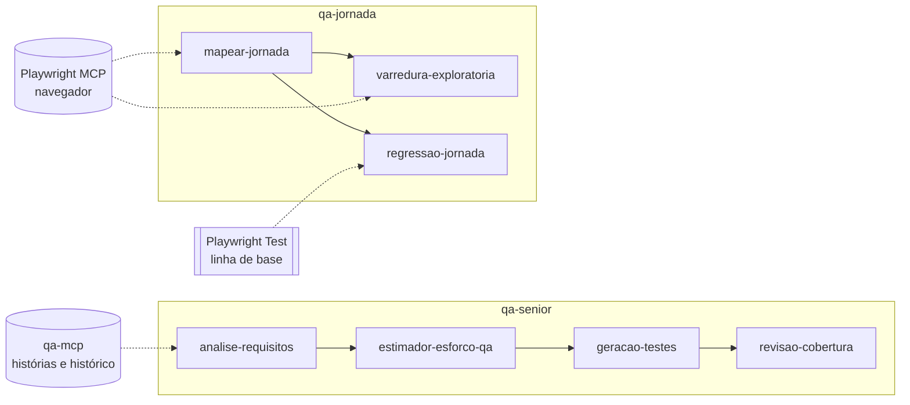

# qa-agents

Agentes de QA para **VS Code + GitHub Copilot**, empacotados como um [agent plugin](https://code.visualstudio.com/docs/agent-customization/agent-plugins) (padrão Agent Plugins 1.0).

Do refinamento do requisito até a regressão da jornada no navegador: análise de requisitos, estimativa de esforço, geração de casos de teste, revisão de cobertura, mapeamento de jornadas web, varredura exploratória e regressão antes/depois com Playwright.

> Os exemplos incluídos são do domínio de **seguros** (cotação e sinistro), mas os agentes e skills funcionam para qualquer negócio. Veja [Adaptar para o seu domínio](#adaptar-para-o-seu-domínio).

---

## Sumário

- [O que vem no plugin](#o-que-vem-no-plugin)
- [Como funciona](#como-funciona)
- [Pré-requisitos](#pré-requisitos)
- [Instalação](#instalação)
- [Configuração](#configuração)
- [Como usar](#como-usar)
- [Estrutura do repositório](#estrutura-do-repositório)
- [Segurança](#segurança)
- [Adaptar para o seu domínio](#adaptar-para-o-seu-domínio)
- [Avaliação (evals)](#avaliação-evals)
- [Contribuindo](#contribuindo)

---

## O que vem no plugin

### Agentes

| Agente | Para quê |
|---|---|
| **qa-senior** | Requisitos, estimativa, casos de teste e cobertura. Trabalha com texto e arquivos. |
| **qa-jornada** | Jornadas web: mapeia no navegador, caça bugs e roda regressão antes/depois. Só em homologação. |

### Skills

| Skill | Agente | O que faz |
|---|---|---|
| `analise-requisitos` | qa-senior | Avalia prontidão e testabilidade, aponta ambiguidades com citação do texto, gera perguntas de refinamento e critérios de aceite em Gherkin |
| `estimador-esforco-qa` | qa-senior | Estima em pontos Fibonacci (1 ponto ≈ 2h) a partir de complexidade funcional, técnica e automação reaproveitável, com script determinístico |
| `geracao-testes` | qa-senior | Gera casos de teste em tabela: História/ Requisito, ID, Teste, Descrição, Precondição, Resultado esperado, Dado, Quando (passos detalhados), Então |
| `revisao-cobertura` | qa-senior | Matriz de rastreabilidade critério × caso e lista do que falta testar |
| `mapear-jornada` | qa-jornada | Percorre a jornada no navegador e gera um `mapa.yaml` com etapas, campos, validações, APIs e dados dinâmicos |
| `varredura-exploratoria` | qa-jornada | Explora a jornada com heurísticas de teste e entrega relatório de bugs com passos e evidências |
| `regressao-jornada` | qa-jornada | Grava a linha de base e compara depois da melhoria (API, valores na tela, estrutura e imagem) com Playwright Test |

### Servidores MCP

| Servidor | Para quê |
|---|---|
| `playwright` | Navegador controlado pelo agente, restrito à homologação |
| `qa-mcp` | Opcional: conexão com seus sistemas (histórias, histórico de estimativas, gestão de testes) |

---

## Como funciona



- **Agente** = papel, regras e ferramentas permitidas.
- **Skill** = o procedimento de cada tarefa (carregado só quando é usado).
- **MCP** = acesso a sistemas externos (navegador, Jira etc.).
- Na regressão, **a IA gera e interpreta, e o Playwright executa**: antes e depois rodam exatamente o mesmo percurso.

---

## Pré-requisitos

- VS Code com GitHub Copilot e a configuração `chat.plugins.enabled` ativada (em algumas empresas ela é gerenciada pelo administrador).
- Python 3 (scripts de estimativa e de resumo da regressão, só biblioteca padrão).
- Para o **qa-jornada**: Node.js 20.12 ou superior.

---

## Instalação

### Pelo Git (recomendado)

1. `Ctrl+Shift+P` → **Chat: Install Plugin from Source**
2. Cole a URL deste repositório: `https://github.com/SEU-USUARIO/qa-agents`

### Local (para desenvolver o plugin)

1. Clone ou baixe este repositório.
2. `Ctrl+Shift+P` → **Preferences: Open User Settings (JSON)** e adicione (no Windows, use `/` no caminho):

   ```json
   "chat.plugins.enabled": true,
   "chat.plugins.paths": {
       "C:/caminho/para/qa-agents": true
   }
   ```

3. `Ctrl+Shift+P` → **Developer: Reload Window**.

Para conferir: **Chat: Open Customizations** → **Plugins**. Devem aparecer os 2 agentes e as 7 skills.

---

## Configuração

### Playwright (agente qa-jornada)

1. Em `mcp.json`, no servidor `playwright`, troque `https://homolog.SEU-DOMINIO.com.br` pelo endereço de homologação. O `--allowed-origins` impede o navegador do agente de abrir outros sites (separe vários com `;`).
2. Na primeira regressão, o agente cria a pasta `qa-jornadas/` no seu projeto, instala o `@playwright/test` (pede confirmação) e pede que você crie o `.env`:

   ```env
   QA_BASE_URL=https://homolog.SEU-DOMINIO.com.br
   QA_USUARIO=
   QA_SENHA=
   ```

3. Adicione ao `.gitignore` do seu projeto:

   ```gitignore
   qa-jornadas/.env
   qa-jornadas/.resultados/
   qa-jornadas/.mcp-saida/
   qa-jornadas/node_modules/
   ```

As opções do Playwright MCP podem mudar entre versões: confira com `npx @playwright/mcp@latest --help`.

### qa-mcp (opcional)

Sem ele, os agentes funcionam normalmente com texto colado ou arquivos. Para conectar seus sistemas:

1. Em `mcp.json`, troque `https://SEU-SERVIDOR/mcp` pela URL do seu servidor MCP.
2. O token é pedido na primeira conexão (campo de senha) e não fica salvo no repositório.
3. Ferramentas esperadas:

| Ferramenta | Uso |
|---|---|
| `buscar_historia` | Buscar história/épico por ID |
| `historico_estimativas` | Esforço real de histórias semelhantes |
| `listar_bugs_por_modulo` | Áreas com mais defeitos |
| `criar_casos_teste` | Gravar casos na ferramenta de gestão de testes (sempre com confirmação) |

Se os nomes forem diferentes no seu servidor, ajuste as skills e os agentes.

---

## Como usar

Abra o chat do Copilot (`Ctrl+Alt+I`), escolha o agente no seletor e peça.

### qa-senior

| Quero | Exemplo |
|---|---|
| Refinamento | "Faça o refinamento desta história: [cole o texto]" |
| Estimativa | "Estime esta história em pontos e horas: [texto]" |
| Casos de teste | "Gere os casos de teste para evals/historias/HIST-001.md" |
| Fluxo completo | "Analise, estime e gere os casos de teste para HIST-1234" |
| Cobertura | "Revise a cobertura destes casos contra os critérios de aceite" |
| Arquivo para Excel | "Gere os casos de teste e salve em CSV" |

Também dá para chamar uma skill direto digitando `/` no chat (ex.: `/geracao-testes`).

### qa-jornada

```text
Mapeie a jornada cotacao-residencial a partir de https://homolog.../cotacao
(massa: CEP 01001-000, Casa, R$ 300.000,00)

Faça uma varredura exploratória na etapa de coberturas da jornada cotacao-residencial

Grave a linha de base da jornada cotacao-residencial

Rode a regressão da cotacao-residencial. A mudança esperada é o novo campo
"Possui alarme?" na etapa 2.
```

Quando o navegador abrir a tela de login, entre manualmente e avise o agente no chat. Ele nunca pede senha.

Exemplo de resultado da regressão:

```text
Etapas com falha: E3 - Resultado (cálculo do prêmio)
- Diferença 1 (API):   "premio_total": 412.8  →  0
- Diferença 2 (tela):  "Prêmio: R$ 412,80"    →  "Prêmio: R$ 0,00"
- Diferença 3 (imagem): E3-resultado-diff.png
```

### Onde ficam os arquivos gerados

Tudo o que os agentes geram fica no **seu projeto**, nunca na pasta do plugin:

```text
qa-jornadas/
├── playwright.config.ts
├── .env                      # não versionar
└── <jornada>/
    ├── mapa.yaml
    ├── evidencias/
    ├── varreduras/AAAA-MM-DD-relatorio.md
    ├── jornada.spec.ts
    ├── linha-de-base/
    └── regressoes/AAAA-MM-DD-relatorio.md
```

---

## Estrutura do repositório

```text
qa-agents/
├── plugin.json                         # manifesto (Agent Plugins 1.0)
├── mcp.json                            # servidores MCP (portável)
├── skills/                             # skills (portáveis)
│   ├── analise-requisitos/
│   │   └── referencias/dominios/       # checklists por domínio (ex.: seguros.md)
│   ├── estimador-esforco-qa/
│   │   └── scripts/calcular_estimativa.py
│   ├── geracao-testes/
│   │   ├── templates/  exemplos/  referencias/
│   ├── revisao-cobertura/
│   ├── mapear-jornada/
│   ├── varredura-exploratoria/
│   └── regressao-jornada/
│       ├── templates/                  # playwright.config.ts, jornada.spec.ts
│       └── scripts/resumir_resultado.py
├── com.github.copilot/                 # específico do Copilot
│   └── agents/
│       ├── qa-senior.agent.md
│       └── qa-jornada.agent.md
├── evals/                              # golden set para validar mudanças
├── CHANGELOG.md
└── README.md
```

Pelo padrão Agent Plugins 1.0, **skills e MCP são portáveis** para outros clientes compatíveis. Os agentes ficam em `com.github.copilot/` porque são específicos do Copilot; outros clientes ignoram essa pasta.

---

## Segurança

- **Só homologação:** o Playwright MCP é restrito por `--allowed-origins` e o `playwright.config.ts` se recusa a rodar se `QA_BASE_URL` não for de homologação.
- **Sem operações reais:** os agentes param antes de contratar, pagar, emitir ou excluir, e os testes bloqueiam essas rotas como rede de segurança.
- **Sem senhas no chat ou no código:** login manual no navegador do agente e credenciais via `.env`.
- **Dados fictícios (LGPD):** exemplos, evals e testes usam só massa de teste.
- **Confirmação humana:** gravar casos em sistemas externos ou atualizar a linha de base exige "sim" explícito.
- **Evidência obrigatória:** bug sem passos e evidência é reportado como suspeita, não como bug.

---

## Adaptar para o seu domínio

- **Checklist do domínio:** crie `skills/analise-requisitos/referencias/dominios/<dominio>.md` (ex.: `ecommerce.md`). Os agentes passam a usá-lo quando o requisito for desse domínio.
- **Exemplos de casos de teste:** troque ou adicione arquivos em `skills/geracao-testes/exemplos/`. Mantenha pelo menos um exemplo com valor-limite e um com regra de cálculo: é isso que ensina o modelo a sair do caminho feliz.
- **Padrão de casos de teste:** ajuste as colunas em `skills/geracao-testes/SKILL.md` e `templates/caso-de-teste.md`.
- **Calibração da estimativa:** `skills/estimador-esforco-qa/referencias/fatores-complexidade.md` e o script (mantenha os dois iguais).
- **Heurísticas de varredura:** `skills/varredura-exploratoria/referencias/heuristicas.md`.

---

## Avaliação (evals)

A pasta `evals/` tem histórias fictícias e o resultado esperado. Rode os agentes nelas antes e depois de mudar uma skill e compare (detalhes em [`evals/README.md`](evals/README.md)). Critérios sugeridos:

- cobertura de pelo menos 90% dos casos esperados;
- estimativa com no máximo 1 degrau Fibonacci de diferença do esforço real.

---

## Contribuindo

1. Crie uma branch e faça a alteração.
2. Rode os evals e registre o resultado no PR.
3. Atualize `version` em `plugin.json` e o `CHANGELOG.md` (versionamento semântico).
4. Nunca inclua dados reais de clientes, senhas ou URLs de produção.

---

## Licença

Defina a licença do projeto (ex.: MIT ou uso interno) antes de publicar.
